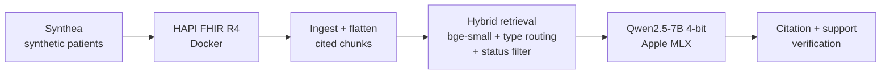

# LocalChart

**On-device clinical record assistant over HL7 FHIR data.** It answers questions about a patient's history with record-level citations, and runs fully locally on a MacBook using a 4-bit LLM via Apple MLX (no external API calls).

## Why
Clinical data is sensitive, and long patient histories don't fit in a prompt. LocalChart keeps inference on-device and uses status-aware retrieval so a 7B model can answer accurately from records that range from 4k to 72k+ tokens. An automated eval harness checks every answer against structured FHIR ground truth.

## Architecture


## Results (held-out patients)
Questions were auto-generated with ground truth from structured FHIR resources: active conditions, current medications, allergies, and "is the patient taking X?" (should abstain). Tuning used 20 patients; the numbers below are from **36 held-out patients**, compared on the 34 both configs could process.

| Config | Precision | Recall | F1 | Citation acc. | Abstention acc. | Cold latency | Prompt tokens |
|---|---|---|---|---|---|---|---|
| Full record in context | 73.4% | 83.4% | 78.1% | 77.9% | 86.9% | 35.9s | 10,513 |
| **RAG v2 (status-aware hybrid)** | **85.4%** | **91.7%** | **88.5%** | **94.6%** | **90.5%** | **4.9s** | **928** |

- Full-context prompting **couldn't process 2/36 patients** (47k and 72k tokens). Before a context guard was added, the 72k-token prompt crashed the local inference server. RAG v2 handled all 36.
- Hardware: MacBook Air M5, 32 GB. Model: `mlx-community/Qwen2.5-7B-Instruct-4bit`.

<details><summary>Tuning-set results (20 patients)</summary>

| Config | F1 | Citation acc. | Abstention acc. | Cold latency | Prompt tokens |
|---|---|---|---|---|---|
| Full context | 73.5% | 61.9% | 88.2% | 57.5s | 12,208 |
| RAG v1 (hybrid) | 78.9% | 72.4% | 94.1% | 13.5s | 1,935 |
| RAG v2 (status-aware) | 95.5% | 97.3% | 94.1% | 7.8s | 911 |

The tuning → held-out F1 drop (95.5% → 88.5%) is expected: v2's design was informed by tuning-set failures.
</details>

## What I learned
- **Citation existence ≠ citation correctness.** An early checker only verified that cited IDs existed, and missed the model citing the *wrong* record. The harness now verifies that each cited record names the claimed item and has the right status.
- **Status-aware retrieval was the biggest win.** Removing resolved and stopped records before generation for "current/active" questions improved F1 more than any prompt change.
- **Measure latency honestly.** MLX prompt caching makes repeat questions on the same patient look ~1s; the table reports cold (first-question) latency.
- **Data quirks matter.** Synthea encodes contraceptive packs as `{7 (...) / ...} Pack [Brand]`; bracketed names confused the model's citation format until normalized.

## Metrics
- **Precision / recall:** fuzzy-matched answer items vs FHIR ground truth (active `Condition` disorders, active `MedicationRequest`, active `AllergyIntolerance`)
- **Citation accuracy:** % of cited items whose cited record exists, names the item, and is active
- **Abstention accuracy:** % of questions with no true answer where the model correctly says "Not found in the record"

## Quickstart
```bash
brew install uv openjdk@17 && brew install --cask orbstack
uv sync
# synthetic data
cd data && curl -LO https://github.com/synthetichealth/synthea/releases/download/master-branch-latest/synthea-with-dependencies.jar
java -jar synthea-with-dependencies.jar -p 50 Massachusetts && cd ..
docker run -d --name hapi -p 8080:8080 hapiproject/hapi:latest
uv run python scripts/load_fhir.py
uv run python -m scripts.build_chunks
# local model (separate terminal)
uv run mlx_lm.server --model mlx-community/Qwen2.5-7B-Instruct-4bit --port 8081
# ask
uv run python -m scripts.ask "What medications is the patient currently taking?"
# evaluate
uv run python -m eval.build_questions
uv run python -m eval.run_eval --mode rag --retrieval v2 --offset 20 --limit 36 --tag heldout_rag_v2
```

## Repo layout

## Limitations & next steps
- Synthetic data only; real clinical notes would be messier.
- Scoring uses fuzzy string matching (threshold 0.6); 4 question types.
- Known failure modes: listing "(finding)" items when a patient has no disorders; some medication misses on held-out patients.
- Next: findings-vs-disorders prompt rule, a second model for comparison, FastAPI + Streamlit demo.

*All patient data is synthetic (Synthea). Not for clinical use.*
